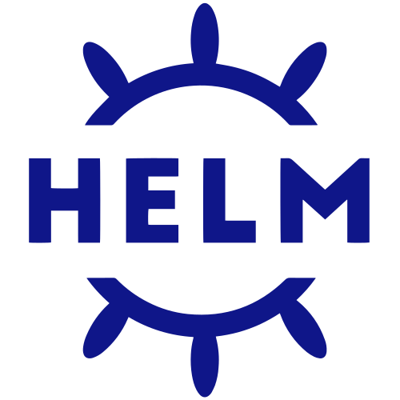

# Helm in Practice

  

> _Learn Helm by installing real charts and building your own, one concept at a time._

> **Problem**: _TODO_
>
> **Solution**: _TODO_

## What You'll Learn

_TODO_

## Prerequisites

_TODO_ — 建議先完成 [Kubernetes in Practice](https://github.com/r97221004/k8s-tutorial)。

## Table of Contents

**Part 1 — What is Helm?**

- [**The Role of Helm in Kubernetes**](docs/helm-intro/role-of-helm.md) — Kubernetes has no idea which objects form one app; Helm packages them as charts and tracks installs as releases.
- [**Benefits and Limitations of Helm**](docs/helm-intro/benefits.md) — seven benefits and five limitations: simpler deployments, consistent environments and rollbacks, weighed against templating complexity, chart security, in-cluster state and risky upgrades.
- [**Helm vs. Kustomize**](docs/helm-intro/helm-vs-kustomize.md) — templates and values vs. base and patches: the same change both ways, and when to use which.
- [**Helm Architecture**](docs/helm-intro/architecture.md) — how developers, chart repositories and CI/CD fit together; the chart files and common commands; and what `helm install` does, from rendering to the release Secret.

**Part 2 — Installing Tools**

- [**Installing Tools**](docs/installing-tools/install-tools.md) — a single-node kubeadm cluster plus Helm and k9s, via the companion Ansible tutorial.

**Part 3 — Helm Fundamentals**

- [**Changes to Bitnami Charts and Images**](docs/helm-fundamentals/bitnami-changes.md) — since August 2025 free Bitnami images come only as `latest`: what that means for the WordPress chart, and the legacy workaround for older installs.
- [**Exploring Artifact Hub**](docs/helm-fundamentals/artifact-hub.md) — find charts, read a chart's page, and choose between charts for the same software.
- [**Managing Helm Repositories**](docs/helm-fundamentals/managing-repositories.md) — `helm repo add`, `update`, `search` and `pull`, the local index cache, and OCI registries.
- [**Installing the WordPress Chart**](docs/helm-fundamentals/installing-wordpress.md) — a default StorageClass, one `helm install`, and what it created. *Lab:* open the site through a port-forward.
- [**Exploring the Chart's Configuration**](docs/helm-fundamentals/exploring-configuration.md) — `helm show` for a chart's defaults, `helm get` for what a release used.
- [**Uninstalling a Release**](docs/helm-fundamentals/uninstalling.md) — `helm uninstall`, `--keep-history`, and what uninstall leaves behind.
- [**Cleaning Up Kubernetes Resources**](docs/helm-fundamentals/cleaning-up.md) — the zombie volume problem, and a cleanup checklist. *Lab:* reinstall onto a leftover PVC and watch it fail.
- [**Setting Values via the CLI**](docs/helm-fundamentals/values-cli.md) — `--set` syntax, the type trap, and which values survive an upgrade.
- [**Setting Values via Files**](docs/helm-fundamentals/values-files.md) — values files with `-f`, layering, precedence, and keeping them in Git.

**Part 4 — Creating Our Own Helm Charts**

- [**Creating Our Own Helm Charts**](docs/creating-charts/overview.md) — _TODO_
