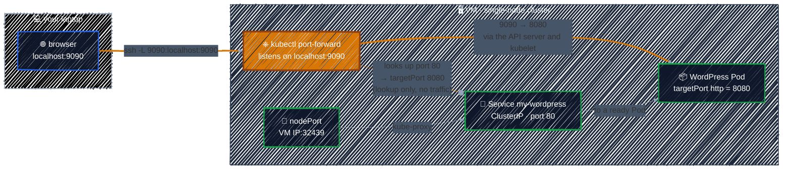

# Installing the WordPress Chart

> One `helm install` creates a WordPress site and its MariaDB database: about 15 Kubernetes objects, a generated password, and two persistent volumes.

---

Time for a real install. WordPress is a good first chart: it's an app plus a database (a chart [dependency](../helm-intro/benefits.md#-versioned-packages)), with Secrets, persistent storage and a long list of values, so it touches everything this part covers.

### Before you start: storage

WordPress and MariaDB each ask for a **PersistentVolumeClaim**, and a PVC needs a **StorageClass** to create the actual volume.

- **k3s** ships a default StorageClass called `local-path`. Nothing to do.
- **kubeadm** ships none, so the PVCs would stay `Pending` forever. Install Rancher's local-path-provisioner once and make it the default:

```bash
kubectl apply -f https://raw.githubusercontent.com/rancher/local-path-provisioner/v0.0.37/deploy/local-path-storage.yaml
kubectl patch storageclass local-path \
  -p '{"metadata":{"annotations":{"storageclass.kubernetes.io/is-default-class":"true"}}}'
```

Either way, confirm:

```bash
kubectl get storageclass    # local-path (default)
```

> local-path stores each volume in a directory on the node's disk. That's fine for a single-node lab, not for production: if the node dies, the data goes with it. Background in [k8s-tutorial → Volumes](https://github.com/r97221004/k8s-tutorial/blob/master/docs/config-and-data/volumes.md).

### A namespace for the lab

Put everything in its own namespace, so it's easy to inspect and easy to [clean up](cleaning-up.md) later. Then make it the default for your current context, so neither `kubectl` nor `helm` needs `-n` on every command:

```bash
kubectl create namespace wordpress
kubectl config set-context --current --namespace=wordpress
```

Helm uses the namespace of your current kubeconfig context, exactly like `kubectl`. The rest of this part assumes you're in `wordpress`.

### Install

Refresh the repository index from the [previous page](managing-repositories.md), then install:

```bash
helm repo update bitnami
helm install my-wordpress bitnami/wordpress --version 34.2.7
```

| Part | Meaning |
|------|---------|
| `my-wordpress` | the **release name**: your name for this installed copy. Every object's name is built from it. |
| `bitnami/wordpress` | the **chart**: repository name + chart name |
| `--version 34.2.7` | the **chart version**. Without it, Helm installs the newest one. Pinning it makes the lab repeatable. |

> A newer chart version is probably out by the time you read this. You can drop `--version` or use the newest; the steps are the same.

Helm renders the chart, sends the objects to the cluster and returns right away:

```text
NAME: my-wordpress
LAST DEPLOYED: …
NAMESPACE: wordpress
STATUS: deployed
REVISION: 1
DESCRIPTION: Install complete
TEST SUITE: None
NOTES:
CHART NAME: wordpress
CHART VERSION: 34.2.7
APP VERSION: 7.1.4

⚠ WARNING: Since August 28th, 2025, only a limited subset of images/charts are available for free.
…
** Please be patient while the chart is being deployed **

Your WordPress site can be accessed through the following DNS name from within your cluster:

    my-wordpress.wordpress.svc.cluster.local (port 80)
…
```

Everything after `NOTES:` comes from the chart's `templates/NOTES.txt`: instructions the chart author wrote for you, printed after every install and upgrade. You can show them again any time with `helm get notes my-wordpress`.

> **About the ⚠ WARNING:** you can ignore it for this lab. Since August 2025, Bitnami's free images come only with the `latest` tag ([announcement](https://github.com/bitnami/containers/issues/83267)), so you can't pin the WordPress version, and `helm rollback` restores the YAML but not the old image. Fine for a lab, not for production.

> **`deployed` doesn't mean ready.** By default `helm install` returns as soon as the objects are accepted by the API server, not when the Pods are running. Add `--wait` to make Helm wait until they're ready (up to `--timeout`, 5 minutes by default). Don't run the install again now: the release name `my-wordpress` is taken. Keep the flag for the next time you install something.

### Watch it start

```bash
kubectl get pods -w     # Ctrl+C to stop watching; or open k9s
```

WordPress waits for MariaDB to be ready, then runs its first-time setup, so give it a few minutes. Both Pods should end up `1/1 Running`:

```text
NAME                            READY   STATUS    RESTARTS   AGE
my-wordpress-5d8c7f9b6d-x2k4p   1/1     Running   0          3m
my-wordpress-mariadb-0          1/1     Running   0          3m
```

If they don't get there:

| You see | Likely cause | Check |
|---------|--------------|-------|
| Pods and PVCs still `Pending` after a minute or two | no default StorageClass. (A few seconds of `Pending` right after install is normal: local-path creates the volume only once a Pod is scheduled.) | `kubectl get pvc`, `kubectl get storageclass`; see [storage](#before-you-start-storage) |
| `ImagePullBackOff` / `ErrImagePull` | the VM can't reach Docker Hub, or hit its pull rate limit | `kubectl describe pod <name>`, Events at the bottom |
| WordPress `Running` but `0/1` for a long time | still initializing, or can't reach the database | `kubectl logs deploy/my-wordpress -f` |
| `CrashLoopBackOff` | usually a database password mismatch | `kubectl logs deploy/my-wordpress`; see [the zombie volume problem](cleaning-up.md#the-zombie-volume-problem) |

### What one command created

Every object the chart created carries the label `app.kubernetes.io/instance=my-wordpress`:

```bash
kubectl get deploy,sts,svc,pvc,secret,configmap -l app.kubernetes.io/instance=my-wordpress
```

| Kind | Name | From |
|------|------|------|
| Deployment | `my-wordpress` | the WordPress chart |
| StatefulSet | `my-wordpress-mariadb` | the MariaDB **subchart** |
| Service | `my-wordpress`, `my-wordpress-mariadb`, `my-wordpress-mariadb-headless` | both |
| PersistentVolumeClaim | `my-wordpress` (WordPress files), `data-my-wordpress-mariadb-0` (database) | both |
| Secret | `my-wordpress`, `my-wordpress-mariadb` (generated passwords) | both |
| ConfigMap, NetworkPolicy, PodDisruptionBudget, ServiceAccount | … | both |

That's the cluster's view. Helm has its own, and it sees all of it as one release:

```bash
helm list
```

```text
NAME          NAMESPACE  REVISION  UPDATED  STATUS    CHART              APP VERSION
my-wordpress  wordpress  1         …        deployed  wordpress-34.2.7   7.1.4
```

`helm status my-wordpress` shows the same summary `helm install` printed, NOTES included. To see exactly what Helm sent to the cluster, read the rendered manifest:

```bash
helm get manifest my-wordpress                                   # every object, as YAML
helm get manifest my-wordpress | grep '^kind:' | sort | uniq -c  # count them by kind
```

Compare it with the `kubectl` table above: one PVC is missing from the manifest, `data-my-wordpress-mariadb-0`. Helm didn't create that one. The StatefulSet's `volumeClaimTemplates` did, which is why [`helm uninstall` leaves it behind](uninstalling.md).

### Open the site

The chart creates a `LoadBalancer` Service by default. Its `EXTERNAL-IP` stays `<pending>`: a bare kubeadm cluster has no load balancer, and on k3s the built-in ServiceLB can't take ports 80 and 443 because Traefik already holds them. The simplest way in, on either cluster, is a port-forward on the VM:

If you're already logged in to the VM, log out first, then reconnect with the tunnel:

```bash
# from your laptop: log in to the VM, forwarding your port 9090 to the VM's port 9090
ssh -L 9090:localhost:9090 <YOUR_USER>@<YOUR_VM_IP>

# then, in that same SSH session: forward the VM's port 9090 to a WordPress Pod
# (80 is the Service's port; kubectl looks up its targetPort and connects to the Pod's 8080)
kubectl port-forward svc/my-wordpress 9090:80
```

`-L` reads as `<laptop port>:<host>:<port>`, and the host is resolved **on the VM**:

| Part | Meaning |
|------|---------|
| `9090` (first) | the port your laptop listens on: what you open in the browser |
| `localhost` | the VM itself, not your laptop |
| `9090` (second) | the VM's port 9090, where `kubectl port-forward` listens |

The traffic travels inside the SSH connection on port 22, so the cloud firewall (for example an Azure NSG) needs no extra rule. The two 9090s don't have to match: with `-L 7000:localhost:9090` you'd open `localhost:7000` instead.

`kubectl` confirms where it really connects:

```text
Forwarding from 127.0.0.1:9090 -> 8080
Forwarding from [::1]:9090 -> 8080
```

The port-forward keeps running until you press Ctrl+C. While it runs, your laptop's `localhost:9090` reaches WordPress through the SSH tunnel. (Any free local port works; 9090 just keeps it apart from the container's own 8080 below.)



The bold orange path is what you just set up, and the thin orange line is the lookup behind it: `svc/my-wordpress` only tells `kubectl` which Pod to pick and which container port (`targetPort`) the Service's port 80 maps to; the traffic then goes straight to that one Pod, so if the Pod restarts, run the port-forward again. The gray dashed path is how the `LoadBalancer` Service itself is reached, and it involves three different ports:

| Port | Value | Listens on | Used by |
|------|-------|------------|---------|
| `nodePort` | 32439 (random, 30000–32767) | every node's IP | clients outside the cluster |
| `port` | 80 | the Service's ClusterIP | other Pods: `my-wordpress:80` |
| `targetPort` | `http` = 8080 | the container | where the Service delivers traffic |

A `LoadBalancer` Service always gets a nodePort too: the external load balancer is meant to forward to it. So even with `EXTERNAL-IP` stuck at `<pending>`, the site already answers on port 32439 of the VM (check yours with `kubectl get svc my-wordpress`). [Setting Values via the CLI](values-cli.md) pins it to a fixed `NodePort` and reaches it from your laptop.

Open <http://localhost:9090> for the blog and <http://localhost:9090/wp-admin> for the admin page. The username is `user`; the chart generated a random password and stored it in a Secret:

```bash
kubectl get secret my-wordpress -o jsonpath='{.data.wordpress-password}' | base64 -d; echo
```

Every one of these defaults (the `LoadBalancer` Service, the `user` login, the random password) comes from the chart's values. The [next page](exploring-configuration.md) shows where to find them, and [Setting Values via the CLI](values-cli.md) changes them.

---

[← Managing Helm Repositories](managing-repositories.md) · [↑ Contents](../../README.md) · [Exploring the Chart's Configuration →](exploring-configuration.md)
