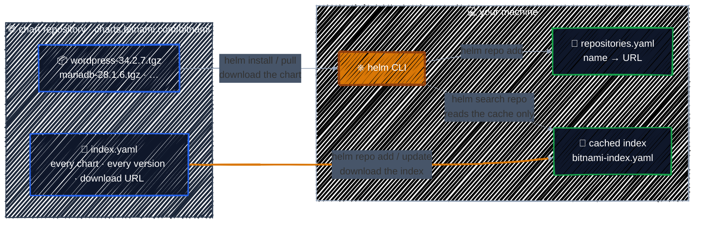

# Managing Helm Repositories

> A chart repository is a web server with an index of charts. `helm repo` registers repositories on your machine, keeps a local copy of their index, and lets you search and download charts by name.

---

To install `bitnami/wordpress` by name, Helm first needs to know where `bitnami` lives. That's what `helm repo` manages. Everything on this page runs on your machine; none of it needs the cluster.

### How a repository works



A classic Helm repository is just files on a web server: an `index.yaml` listing every chart and version, and the chart packages it points at. Helm keeps two things locally:

- **`repositories.yaml`**: the short name you chose (`bitnami`) and its URL.
- **The cached index**: a copy of the repository's `index.yaml`. `helm search repo` reads this copy, never the network.

`helm env` shows where both live on your machine (`HELM_REPOSITORY_CONFIG` and `HELM_REPOSITORY_CACHE`).

### Add a repository

```bash
helm repo add bitnami https://charts.bitnami.com/bitnami
```

```text
"bitnami" has been added to your repositories
```

The name `bitnami` is yours to choose. It's the prefix you'll type in `bitnami/wordpress`.

### List, search and inspect

```bash
helm repo list
```

```text
NAME     URL
bitnami  https://charts.bitnami.com/bitnami
```

Search the cached index by keyword:

```bash
helm search repo wordpress
```

```text
NAME                     CHART VERSION  APP VERSION  DESCRIPTION
bitnami/wordpress        34.2.7         7.1.4        WordPress is the world's most popular blogging ...
bitnami/wordpress-intel  2.1.31         6.1.1        DEPRECATED WordPress for Intel is the most popu...
```

Add `--versions` to see every release of a chart, not just the newest:

```bash
helm search repo bitnami/wordpress --versions | head -4
```

Look inside a chart without installing it:

```bash
helm show chart  bitnami/wordpress    # Chart.yaml: version, appVersion, dependencies
helm show values bitnami/wordpress    # every setting and its default
helm show readme bitnami/wordpress    # the chart's documentation
```

> Your output will show newer versions than the ones on this page. That's expected: the cached index is a snapshot of the repository at the moment you added or updated it.

### Update the cached index

The cache doesn't refresh itself. When a repository publishes a new chart version, your machine doesn't know until you run:

```bash
helm repo update            # all repositories
helm repo update bitnami    # just one
```

Run it before installing or upgrading, so `helm search repo` and `helm install` see the latest versions. Forgetting it is the usual reason a version you saw on Artifact Hub "doesn't exist".

### Download a chart

`helm install` downloads the chart for you. To keep a copy, for example to read its templates, pull it:

```bash
helm pull bitnami/wordpress --version 34.2.7            # wordpress-34.2.7.tgz
helm pull bitnami/wordpress --version 34.2.7 --untar    # a wordpress/ folder
```

### Remove a repository

> Don't run this now: the next pages install from `bitnami`. If you do, add it back with `helm repo add`.

```bash
helm repo remove bitnami
```

This only removes the name and cached index from your machine. Releases already installed from that repository keep running; Helm stored everything it needs in the release.

### OCI registries: no `repo add` needed

Charts can also live in an **OCI registry**, the same kind of registry that stores container images. There's no index to download: you refer to the chart by its full `oci://` URL.

```bash
helm show chart oci://registry-1.docker.io/bitnamicharts/wordpress --version 34.2.7
```

`helm install`, `helm pull` and the other commands take the same `oci://` reference in place of `bitnami/wordpress`.

| | Classic HTTP repository | OCI registry |
|---|---|---|
| Setup | `helm repo add`, then `helm repo update` | none |
| Chart reference | `bitnami/wordpress` | `oci://registry-1.docker.io/bitnamicharts/wordpress` |
| Search | `helm search repo` | not supported; search Artifact Hub or the registry |
| Publish | upload `.tgz` + regenerate `index.yaml` | `helm push` |

Bitnami offers both. In fact, entries in its HTTP index point at its OCI registry, so `helm install bitnami/wordpress` downloads the same package. This tutorial uses `bitnami/wordpress` because the short name is easier to read.

### Commands on this page

| Command | What it does |
|---------|--------------|
| `helm repo add <name> <url>` | register a repository and download its index |
| `helm repo list` | show registered repositories |
| `helm repo update [name]` | refresh the cached index |
| `helm repo remove <name>` | unregister a repository |
| `helm search repo <keyword>` | search the cached indexes |
| `helm search hub <keyword>` | search Artifact Hub |
| `helm show chart\|values\|readme <chart>` | inspect a chart without installing it |
| `helm pull <chart>` | download a chart package |

---

[← Exploring Artifact Hub](artifact-hub.md) · [↑ Contents](../../README.md) · [Installing the WordPress Chart →](installing-wordpress.md)
