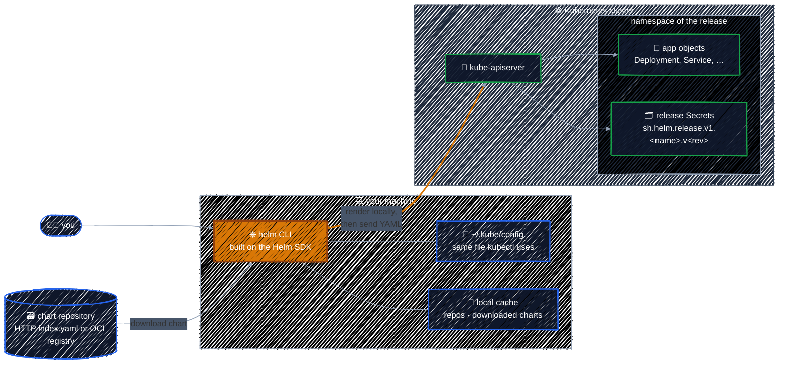

# Helm Architecture

> Helm is a single binary on your machine. It renders charts locally, talks to the same API server as `kubectl`, and stores each release as a Secret in the cluster.

---

Helm has no server of its own. There is nothing to install into the cluster and no Helm Pod to keep running: just the `helm` binary, your kubeconfig, and a few Secrets it writes next to your app.



### The components

| Component | Where it lives | Its job |
|-----------|----------------|---------|
| **Helm CLI** (`helm`) | your machine or a CI runner | the commands you type: `install`, `upgrade`, `list`, … |
| **Helm SDK** | inside the CLI, and inside other tools | the Go library that does the real work: load a chart, render it, apply it, store the release. Argo CD and Flux use it too. |
| **kubeconfig** | `~/.kube/config` | which cluster to talk to and as whom. Helm reads the same file and context as `kubectl`. |
| **Chart repository** | a web server or an OCI registry | where charts are published and downloaded from |
| **Release Secrets** | in the cluster, in the release's namespace | the record of every revision of every release |

### What happens on `helm install`

```bash
helm install web ./my-app -n demo --set replicaCount=3
```

1. **Load the chart.** From a local folder, a `.tgz`, a repository or an OCI registry.
2. **Merge values.** The chart's `values.yaml`, then any `-f` files, then `--set` flags. Later ones win.
3. **Render.** The template engine fills the templates with the merged values and produces plain Kubernetes YAML. This happens **on your machine**; the cluster isn't involved yet.
4. **Apply.** Helm sends the YAML to the kube-apiserver, the same API `kubectl apply` uses. It's subject to the same RBAC: Helm can only do what your kubeconfig user can do.
5. **Record.** Helm writes a Secret in the release's namespace holding revision 1: the chart, the merged values and the rendered YAML.

`helm upgrade` repeats the same steps and writes revision 2. `helm rollback` takes an old revision's stored YAML, applies it, and writes it as a new revision.

### Where releases are stored

Each revision is one Secret of type `helm.sh/release.v1`:

```text
$ kubectl get secrets -n demo -l owner=helm
NAME                        TYPE                 DATA   AGE
sh.helm.release.v1.web.v1   helm.sh/release.v1   1      5m
sh.helm.release.v1.web.v2   helm.sh/release.v1   1      1m
```

That's all `helm list` and `helm history` read. Consequences worth knowing:

- **Releases are per namespace.** `helm list` shows only the current namespace; use `-n <ns>` or `-A` for all of them. Two namespaces can each have a release called `web`.
- **Delete those Secrets and Helm forgets the release**, even though the app keeps running.
- **Old revisions pile up.** `helm upgrade --history-max N` limits how many are kept (the CLI's default is 10).

### No Tiller: why older guides look different

**Helm 2** had a server component called **Tiller**, a Pod inside the cluster that did the installs on Helm's behalf. It needed broad, cluster-wide permissions, so anyone who could reach Tiller could effectively do anything in the cluster.

**Helm 3** removed Tiller completely, and **Helm 4** keeps that design. The client talks to the API server directly with *your* credentials, so Kubernetes RBAC applies to Helm exactly as it does to `kubectl`. If a guide tells you to run `helm init` or install Tiller, it's describing Helm 2 and is out of date.

| | Helm 2 | Helm 3 / 4 |
|---|--------|------------|
| In-cluster component | Tiller | none |
| Permissions | Tiller's (usually cluster-admin) | your kubeconfig user's |
| Release storage | ConfigMaps in Tiller's namespace | Secrets in the release's namespace |
| Release names | unique across the cluster | unique per namespace |

> **Helm 4.** This tutorial installs the latest Helm, which is version 4 (released November 2025). Charts and most commands are the same as Helm 3. A few flags were renamed, e.g. `--atomic` is now `--rollback-on-failure`, and new installs use server-side apply. Where the difference matters, the page will say so.

---

[← Helm vs. Kustomize](helm-vs-kustomize.md) · [↑ Contents](../../README.md) · [Installing Tools →](../installing-tools/overview.md)
