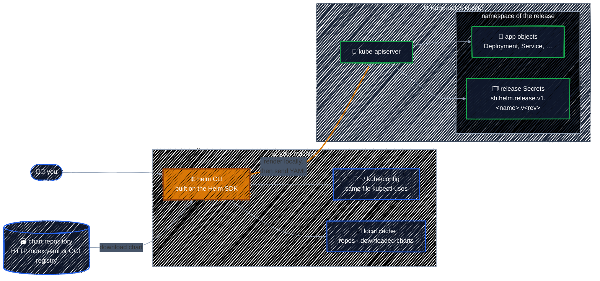

# Helm Architecture

> Helm is a single binary. Developers and CI pipelines run the same `helm` CLI: it packages charts, pushes and pulls them from repositories, renders them locally, and installs them into any cluster its kubeconfig can reach.

---

Helm has no server of its own. There is nothing to install into the cluster and no Helm Pod to keep running: just the `helm` binary, a kubeconfig, chart repositories, and a few Secrets Helm writes next to each app.

### The big picture

A typical team uses Helm in three places: developers build and test charts, repositories store them, and a CI/CD pipeline deploys them to production.

```mermaid
---
config:
  look: handDrawn
  theme: default
  themeVariables:
    fontFamily: '"Comic Sans MS", "Comic Sans", "Segoe Print", "Bradley Hand", cursive'
    clusterBkg: '#FAFAFA'
    clusterBorder: '#94A3B8'
    lineColor: '#94A3B8'
    edgeLabelBackground: '#475569'
  themeCSS: |
    .edgeLabel, .edgeLabel p, .edgeLabel span { color: #FFFFFF !important; }
---
flowchart LR
    subgraph devbox["👩‍💻 developer machine"]
        direction TB
        files["📝 chart files<br/>Chart.yaml · values.yaml<br/>templates/"]
        cli1["⎈ helm CLI"]
        files --> cli1
    end

    subgraph repos["🗃️ chart repositories · HTTP or OCI"]
        direction TB
        repoA["repo A<br/>chart-a.tgz · chart-b.tgz"]
        repoB["repo B<br/>chart-c.tgz · chart-d.tgz"]
    end

    subgraph ci["⚙️ CI/CD · GitHub Actions, GitLab CI, Jenkins"]
        cli2["⎈ helm CLI"]
    end

    subgraph devc["☸️ dev cluster"]
        direction TB
        api1["🚪 Kubernetes API"]
        relA1["📦 release A"]
        relB1["📦 release B"]
        api1 --> relA1
        api1 --> relB1
    end

    subgraph prodc["☸️ prod cluster"]
        direction TB
        api2["🚪 Kubernetes API"]
        relA2["📦 release A"]
        relB2["📦 release B"]
        api2 --> relA2
        api2 --> relB2
    end

    cli1 -->|"package · push"| repos
    cli1 ==>|"install · test · upgrade"| api1
    repos -->|pull| cli2
    cli2 ==>|"install · upgrade · rollback"| api2

    classDef ctrl fill:#0F172A,stroke:#2563EB,stroke-width:2px,color:#FFFFFF
    classDef eng fill:#D97706,stroke:#92400E,stroke-width:3px,color:#FFFFFF
    classDef tgt fill:#0F172A,stroke:#16A34A,stroke-width:2px,color:#FFFFFF
    class files,repoA,repoB ctrl
    class cli1,cli2 eng
    class api1,api2,relA1,relB1,relA2,relB2 tgt
    linkStyle 6,8 stroke:#D97706,stroke-width:3px
    style devbox fill:#000000,stroke:#94A3B8,color:#FFFFFF,fillStyle:solid
    style repos fill:#000000,stroke:#94A3B8,color:#FFFFFF,fillStyle:solid
    style ci fill:#000000,stroke:#94A3B8,color:#FFFFFF,fillStyle:solid
    style devc fill:#1E293B,stroke:#334155,color:#F1F5F9,fillStyle:solid
    style prodc fill:#1E293B,stroke:#334155,color:#F1F5F9,fillStyle:solid
```



1. **Developers** write the chart files and use the `helm` CLI to render, install and test them in a **dev cluster**.
2. When the chart is ready, they **package** it into a `.tgz` and **push** it to a **chart repository**: `helm push` for an OCI registry, or an upload plus `helm repo index` for a classic HTTP repository. A team often uses several: public ones for third-party charts, a private one for its own.
3. A **CI/CD pipeline** runs the same `helm` CLI: it **pulls** the chart from the repository and installs or upgrades it in the **prod cluster**.
4. Each cluster holds several **releases**, each an installed copy of some chart with its own objects and history.

Every `helm` in the picture is the same binary. What changes is only which kubeconfig it uses, and so which cluster it talks to.

> **CI pushes, or the cluster pulls.** Here the pipeline holds prod credentials and runs `helm upgrade` itself. The GitOps alternative is to let Argo CD, running inside the cluster, pull the chart and deploy it, so no pipeline needs cluster access. See [Argo CD in Practice → The GitOps Workflow](https://github.com/r97221004/argoCD-tutorial/blob/master/docs/gitops-intro/gitops-workflow.md).

### The components

| Component | Where it lives | Its job |
|-----------|----------------|---------|
| **Chart files** | a folder in Git, or a packaged `.tgz` | the templates, default values and metadata that describe an app |
| **Helm CLI** (`helm`) | a developer's machine or a CI runner | the commands you type: `package`, `install`, `upgrade`, `list`, … |
| **Helm SDK** | inside the CLI, and inside other tools | the Go library that does the real work: load a chart, render it, apply it, store the release. Argo CD and Flux use it too. |
| **kubeconfig** | `~/.kube/config`, or a CI secret | which cluster to talk to and as whom. Helm reads the same file and context as `kubectl`. |
| **Chart repository** | a web server or an OCI registry | where packaged charts are published and pulled from |
| **Release Secrets** | in the cluster, in the release's namespace | the record of every revision of every release |

### The chart files

A chart is a folder with a fixed layout. `helm create app-chart` scaffolds one like this:

```text
app-chart/
├── Chart.yaml              # name, version, appVersion, dependencies
├── values.yaml             # default values
├── .helmignore             # files to leave out of the package, like .gitignore
├── charts/                 # dependency charts, downloaded here
└── templates/
    ├── NOTES.txt           # message printed after install, e.g. how to reach the app
    ├── _helpers.tpl        # reusable snippets: names, labels
    ├── deployment.yaml     # example object templates: service.yaml,
    ├── …                   #   ingress.yaml, hpa.yaml, serviceaccount.yaml
    └── tests/
        └── test-connection.yaml   # a test Pod that helm test runs
```

Many charts also add a `README.md` and a `values.schema.json` by hand. You'll build a chart file by file in [Part 4](../creating-charts/overview.md).

### Common operations

The commands split into two groups: working with **charts** (the package, on the left of the big picture) and working with **releases** (an installed copy, on the right).

| Command | What it does |
|---------|--------------|
| `helm create` | scaffold a new chart folder |
| `helm lint` / `helm template` | check a chart / render it locally, without installing |
| `helm package` | bundle the folder into a versioned `.tgz`, e.g. `app-chart-2.1.0.tgz` |
| `helm push` / `helm pull` | upload a package to an OCI registry / download one |
| `helm repo add` / `helm repo update` | register a classic HTTP repository / refresh its index |

On the release side are the lifecycle commands from [Benefits](benefits.md#-simpler-deployments): `install`, `upgrade`, `rollback`, `uninstall`, plus `list`, `history`, `status` and `test` to inspect them. [Helm Fundamentals](../helm-fundamentals/overview.md) uses each of these in practice.

### What happens on `helm install`

Zoom in on one `helm` CLI and one cluster:



```bash
helm install my-app ./app-chart -n dev --set web.replicaCount=3
```

1. **Load the chart.** From a local folder, a `.tgz`, a repository or an OCI registry.
2. **Merge values.** The chart's `values.yaml`, then any `-f` files, then `--set` flags. Later ones win.
3. **Render.** The template engine fills the templates with the merged values and produces plain Kubernetes YAML. This happens **on your machine**; the cluster isn't involved yet.
4. **Record, as pending.** Helm writes a Secret in the release's namespace holding revision 1, with status `pending-install`: the chart, the merged values and the rendered YAML.
5. **Apply.** Helm sends the YAML to the kube-apiserver, the same API `kubectl apply` uses. It's subject to the same RBAC: Helm can only do what your kubeconfig user can do.
6. **Mark the result.** The revision's status becomes `deployed`, or `failed` if the apply (or `--wait`) failed.

That order explains statuses you'll see in `helm list`: a release stuck in `pending-install` or `pending-upgrade` means a Helm command was interrupted mid-way, and the next one refuses with "another operation is in progress".

`helm upgrade` repeats the same steps and writes revision 2. `helm rollback` takes an old revision's stored YAML, applies it, and writes it as a new revision.

### Where releases are stored

Each revision is one Secret of type `helm.sh/release.v1`:

```text
$ kubectl get secrets -n dev -l owner=helm
NAME                           TYPE                 DATA   AGE
sh.helm.release.v1.my-app.v1   helm.sh/release.v1   1      5m
sh.helm.release.v1.my-app.v2   helm.sh/release.v1   1      1m
```

That's all `helm list` and `helm history` read. Consequences worth knowing:

- **Releases are per namespace.** `helm list` shows only the current namespace; use `-n <ns>` or `-A` for all of them. That's why `dev` and `prod` can each have a release called `my-app`.
- **Delete those Secrets and Helm forgets the release**, even though the app keeps running.
- **Old revisions pile up.** `helm upgrade --history-max N` limits how many are kept (the CLI's default is 10).

### No Tiller: why older guides look different

**Helm 2** had a server component called **Tiller**, a Pod inside the cluster that did the installs on Helm's behalf. It needed broad, cluster-wide permissions, so anyone who could reach Tiller could effectively do anything in the cluster.

**Helm 3** removed Tiller completely, and **Helm 4** keeps that design. The client talks to the API server directly with *your* credentials, so Kubernetes RBAC applies to Helm exactly as it does to `kubectl`. If a guide tells you to run `helm init` or install Tiller, it's describing Helm 2 and is out of date.

| | Helm 2 | Helm 3 / 4 |
|---|--------|------------|
| In-cluster component | Tiller | none |
| Permissions | Tiller's (usually cluster-admin) | your kubeconfig user's |
| Release storage | ConfigMaps in Tiller's namespace | Secrets in the release's namespace |
| Release names | unique across the cluster | unique per namespace |

> **Helm 4.** This tutorial installs the latest Helm, which is version 4 (released November 2025). Charts and most commands are the same as Helm 3. A few flags were renamed, e.g. `--atomic` is now `--rollback-on-failure`, and new installs use server-side apply. Where the difference matters, the page will say so.

---

[← Helm vs. Kustomize](helm-vs-kustomize.md) · [↑ Contents](../../README.md) · [Installing Tools →](../installing-tools/install-tools.md)
