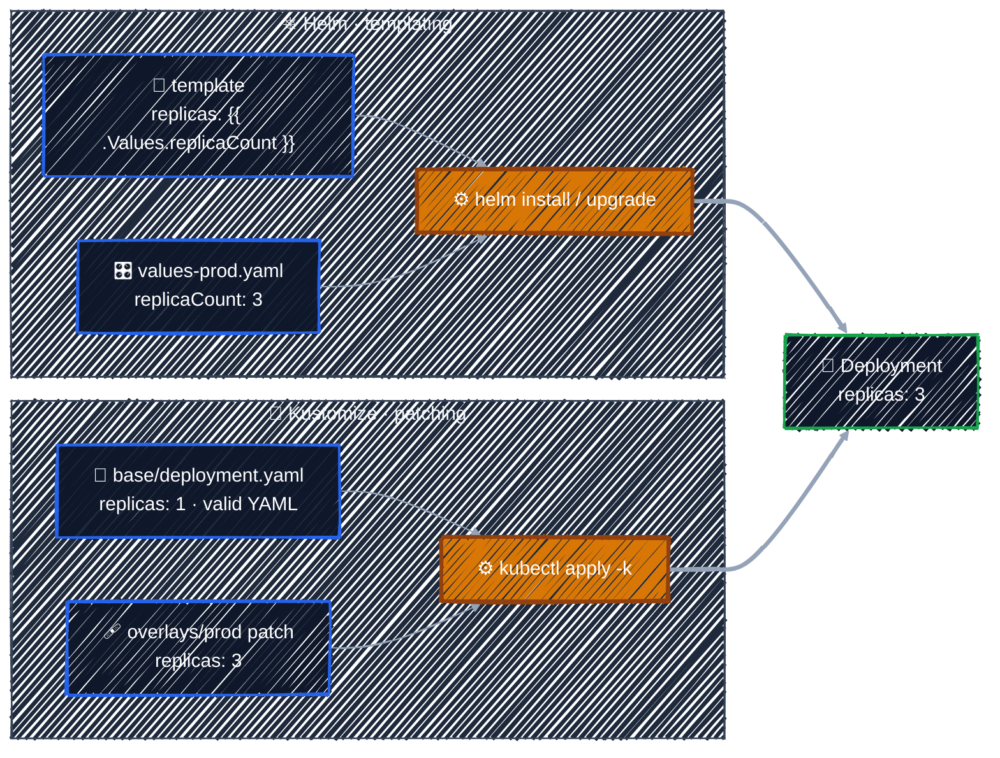

# Helm vs. Kustomize

> Helm fills in blanks in templates. Kustomize patches plain YAML. Both solve "same app, different environments"; only Helm also installs and tracks it.

---

Helm isn't the only answer to per-environment YAML. **Kustomize** is the other common one, and it's built into `kubectl` (`kubectl apply -k`). They start from opposite ideas.

### Two ways to customize YAML



- **Helm** puts placeholders in the YAML and fills them from values. The template on its own isn't valid Kubernetes YAML.
- **Kustomize** keeps a **base** of complete, valid YAML and lays **patches** on top for each environment. Nothing is a placeholder: every file can be applied as it is.

### The same change, both ways

Goal: 1 replica in dev, 3 in prod.

**Helm**: one template, a values file per environment.

```text
my-app/
├── Chart.yaml
├── values.yaml              # replicaCount: 1
└── templates/
    └── deployment.yaml      # replicas: {{ .Values.replicaCount }}
values-prod.yaml             # replicaCount: 3
```

```bash
helm install my-app ./my-app -f values-prod.yaml
```

**Kustomize**: a plain base, an overlay that patches it.

```text
base/
├── kustomization.yaml       # resources: [deployment.yaml]
└── deployment.yaml          # replicas: 1, plain YAML
overlays/prod/
└── kustomization.yaml       # resources: [../../base] + a replicas patch
```

```yaml
# overlays/prod/kustomization.yaml
resources:
  - ../../base
replicas:
  - name: my-app
    count: 3
```

```bash
kubectl apply -k overlays/prod
```

Same Deployment in the cluster. The difference is what you get *around* it.

### Side by side

| | Helm | Kustomize |
|---|------|-----------|
| Approach | templates + values | base + patches (overlays) |
| Source files | Go templates, not valid YAML on their own | plain, valid Kubernetes YAML |
| Install | separate `helm` binary | built into `kubectl` (`-k`) |
| Tracks what's installed | ✅ releases, `helm list` | ❌ applies YAML, then forgets |
| History and rollback | ✅ `helm history`, `helm rollback` | ❌ use Git |
| Clean removal | ✅ `helm uninstall` | ⚠️ `kubectl delete -k`, from the same files |
| Packaging and sharing | ✅ versioned charts in repositories | ❌ share a Git folder |
| Dependencies | ✅ `dependencies:` in `Chart.yaml` | ⚠️ point at remote bases by URL |
| Logic (if, loops) | ✅ full template language | ❌ by design: patches only |
| Learning curve | steeper: template syntax, scopes, helpers | gentler: it's just YAML |
| Typical use | installing third-party software; apps shared across teams | your own apps with a few environment differences |

### Which one to pick

- **Installing someone else's software** (an Ingress controller, Redis, Prometheus): **Helm.** That's how it's published, and the chart already encodes the maintainers' choices.
- **Distributing your own app to other teams or customers**: **Helm.** A versioned chart with documented values is a cleaner contract than "fork this folder".
- **Your own app, a few environments, small differences**: **Kustomize** is often enough, and there's no template language to learn.
- **You need conditionals or loops** (create an Ingress only if enabled, one ConfigMap per item in a list): **Helm.** Kustomize deliberately doesn't do logic.

### Using both

They aren't exclusive. Common combinations:

- **Kustomize on top of a chart.** Render a public chart with `helm template`, then patch the output with Kustomize for the one setting the chart doesn't expose. Kustomize can also pull the chart itself through its `helmCharts` field (requires `kustomize build --enable-helm`).
- **GitOps tools support both.** Argo CD and Flux recognize a Helm chart or a `kustomization.yaml` in a Git folder and render either one, so a team can use Helm for third-party software and Kustomize for its own apps in the same repo.

> This tutorial is about Helm, so from here on everything uses charts. For a hands-on Kustomize walkthrough, see [Kubernetes in Practice → Kustomize](https://github.com/r97221004/k8s-tutorial/blob/master/docs/packaging/kustomize.md).

---

[← Benefits of Using Helm](benefits.md) · [↑ Contents](../../README.md) · [Helm Architecture →](architecture.md)
