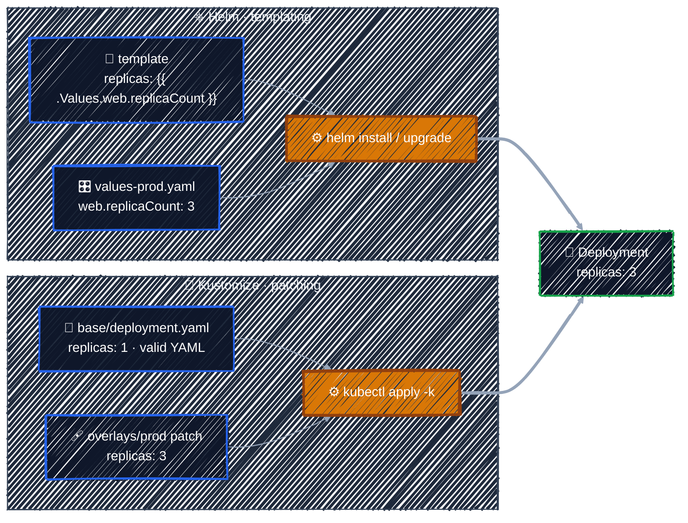

# Helm vs. Kustomize

> Helm fills in blanks in templates. Kustomize patches plain YAML. Both solve "same app, different environments"; only Helm also installs and tracks it.

---

Helm isn't the only answer to per-environment YAML. **Kustomize** is the other common one, and it's built into `kubectl` (`kubectl apply -k`). They start from opposite ideas.

### Two ways to customize YAML



Helm fills blanks in a template; Kustomize lays patches over plain YAML. The example below does the same change both ways.

### The same change, both ways

Goal: the web Deployment from the [previous pages](role-of-helm.md), with two environments:

| | Replicas | Image |
|---|---|---|
| **dev** | 1 | `myorg/web:1.5.0` (trying the next release) |
| **prod** | 3 | `myorg/web:1.4.2` |

#### Helm: fill in the blanks

The template has blanks where the environments differ:

```yaml
# app-chart/templates/deployment-web.yaml
apiVersion: apps/v1
kind: Deployment
metadata:
  name: {{ .Release.Name }}-web
spec:
  replicas: {{ .Values.web.replicaCount }}        # ← blank 1
  selector:
    matchLabels:
      app: {{ .Release.Name }}-web
  template:
    metadata:
      labels:
        app: {{ .Release.Name }}-web
    spec:
      containers:
        - name: web
          # ← blank 2
          image: "myorg/web:{{ .Values.web.tag | default .Chart.AppVersion }}"
          ports:
            - containerPort: 80
```

Each environment's values file fills them:

```yaml
# app-chart/values.yaml: defaults
web:
  replicaCount: 1
  tag: ""            # empty: use appVersion (1.4.2)
```

```yaml
# values-dev.yaml
web:
  tag: "1.5.0"
```

```yaml
# values-prod.yaml
web:
  replicaCount: 3
```

```bash
helm install my-app ./app-chart -n dev  -f values-dev.yaml    # 1 replica,  myorg/web:1.5.0
helm install my-app ./app-chart -n prod -f values-prod.yaml   # 3 replicas, myorg/web:1.4.2
```

#### Kustomize: patch a complete file

The base is complete, ordinary YAML, with no blanks. You could `kubectl apply` it as it is:

```yaml
# base/deployment-web.yaml
apiVersion: apps/v1
kind: Deployment
metadata:
  name: my-app-web
spec:
  replicas: 1
  selector:
    matchLabels:
      app: my-app-web
  template:
    metadata:
      labels:
        app: my-app-web
    spec:
      containers:
        - name: web
          image: myorg/web:1.4.2
          ports:
            - containerPort: 80
```

Each overlay changes only what differs. Dev swaps the image tag with the built-in `images` transformer:

```yaml
# overlays/dev/kustomization.yaml
namespace: dev
resources:
  - ../../base
images:
  - name: myorg/web
    newTag: "1.5.0"
```

Prod uses a **strategic merge patch**: a partial copy of the Deployment containing only the fields to change. Kustomize finds the base object with the same `kind` and `name`, and overwrites those fields:

```yaml
# overlays/prod/replicas-patch.yaml
apiVersion: apps/v1
kind: Deployment
metadata:
  name: my-app-web      # which object to patch
spec:
  replicas: 3           # the only field that changes
```

```yaml
# overlays/prod/kustomization.yaml
namespace: prod
resources:
  - ../../base
patches:
  - path: replicas-patch.yaml
```

```bash
kubectl apply -k overlays/dev    # 1 replica,  myorg/web:1.5.0
kubectl apply -k overlays/prod   # 3 replicas, myorg/web:1.4.2
```

Same two Deployments in the cluster, reached in opposite ways:

- **Helm**: the template knows in advance which fields can change, and values flow *into* those blanks. The template on its own isn't valid YAML, and a field without a blank can't be changed.
- **Kustomize**: the base is complete, valid YAML that doesn't know it will be customized. Patches are laid *over* it, and any field can be changed.

The difference beyond that is what you get *around* the Deployment: releases, history, packaging. That's what the table below compares.

### What Kustomize can change

`images` and `patches` are two of Kustomize's built-in transformers. The common ones:

| Field in `kustomization.yaml` | What it does |
|-------------------------------|--------------|
| `namePrefix` / `nameSuffix` | renames every object, e.g. `dev-my-app-web`, and updates references to them |
| `namespace` | puts every object in one namespace |
| `labels` / `commonAnnotations` | adds labels or annotations to every object |
| `images` | swaps an image name or tag without touching the Deployment |
| `replicas` | sets the replica count of a Deployment or StatefulSet by name |
| `configMapGenerator` / `secretGenerator` | builds ConfigMaps and Secrets from files, with a hash in the name so Pods restart when they change |
| `patches` | changes anything else, with a **strategic merge patch** (a partial YAML object, as above) or a **JSON patch** (`op: replace, path: /spec/...`) |

That's the strength of Kustomize: it can change **any field** of any object, even one nobody planned for. Helm can only change what the chart author exposed as a value, unless you pass its output through Kustomize, as [Using both](#using-both) shows.

### Side by side

| | Helm | Kustomize |
|---|------|-----------|
| Overall purpose | a **package manager**: templating, dependencies and versioned releases | **customize** existing YAML with overlays, also written in YAML |
| Approach | Go templates + values; the templates aren't valid YAML on their own | a base of plain, valid YAML + patches (overlays) |
| Customization | conditionals, loops, functions, but only what the chart exposes | prefixes, labels, images, strategic merge and JSON patches on any field, but no logic |
| Install | separate `helm` binary | built into `kubectl` (`-k`), or the standalone `kustomize` binary for the newest version |
| Tracks what's installed | ✅ releases, `helm list` | ❌ applies YAML, then forgets |
| History and rollback | ✅ `helm history`, `helm rollback` | ❌ use Git |
| Clean removal | ✅ `helm uninstall` | ⚠️ `kubectl delete -k`, from the same files |
| Packaging and sharing | ✅ versioned charts in repositories | ❌ share a Git folder |
| Dependencies | ✅ `dependencies:` in `Chart.yaml` | ⚠️ point at remote bases by URL |
| Complexity | steeper: Go templates and chart structure | gentler: only native YAML, no template language |
| Typical use | packaging apps and their dependencies, versioning them, installing third-party software | per-environment changes (dev, staging, prod) to your own YAML, without duplicating it |

### Which one to pick

- **Installing someone else's software** (an Ingress controller, Redis, Prometheus): **Helm.** That's how it's published, and the chart already encodes the maintainers' choices.
- **Distributing your own app to other teams or customers**: **Helm.** A versioned chart with documented values is a cleaner contract than "fork this folder".
- **Your own app, a few environments, small differences**: **Kustomize** is often enough, and there's no template language to learn.
- **You need conditionals or loops** (create an Ingress only if enabled, one ConfigMap per item in a list): **Helm.** Kustomize deliberately doesn't do logic.

### Using both

They aren't exclusive. Common combinations:

- **Kustomize on top of a chart.** When a public chart doesn't expose the one setting you need, patch its output with Kustomize instead of forking the chart. There are three ways: render with `helm template` and patch the result; let Kustomize pull the chart through its `helmCharts` field (requires `kustomize build --enable-helm`); or keep the Helm release and pass `helm install --post-renderer`, which runs the rendered YAML through Kustomize (or any other program) before applying it. In Helm 4 the post-renderer must be packaged as a Helm plugin; Helm 3 accepted any executable.
- **GitOps tools support both.** Argo CD and Flux recognize a Helm chart or a `kustomization.yaml` in a Git folder and render either one, so a team can use Helm for third-party software and Kustomize for its own apps in the same repo.

---

[← Benefits and Limitations of Helm](benefits.md) · [↑ Contents](../../README.md) · [Helm Architecture →](architecture.md)
