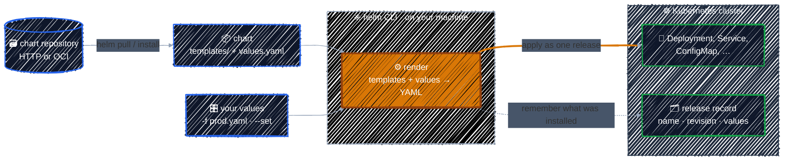

# The Role of Helm in Kubernetes

> Kubernetes runs YAML but has no idea which files belong to one app. Helm packages them, fills in the parts that change, and installs them as one named, versioned unit.

---

Kubernetes understands **objects**: a Deployment, a Service, a ConfigMap. It doesn't understand **applications**. A real app is a dozen objects that have to be created together, configured together, and removed together, and Kubernetes has no word for that group.

### The problem: a folder of YAML

Without Helm, deploying an app usually looks like this:

```text
my-app/
├── deployment.yaml
├── service.yaml
├── configmap.yaml
├── ingress.yaml
└── hpa.yaml
```

```bash
kubectl apply -f my-app/
```

That works for one app in one environment. The trouble starts when you need more:

| You want to… | With plain YAML you… |
|--------------|----------------------|
| deploy to dev, staging and prod | copy the folder three times and edit `replicas`, the image tag and the hostname by hand |
| upgrade to a new image | edit the file, `kubectl apply` again, and hope you remember what the old tag was |
| roll back a bad release | find the old YAML somewhere, if anyone kept it |
| remove the app | delete every object one by one, and miss the one created by hand last month |
| install someone else's software, e.g. Redis | read its docs and copy a few hundred lines of YAML into your repo |
| see what's installed | `kubectl get all` and guess which objects belong together |

Every row is the same gap: **Kubernetes has no idea that these objects are one thing.**

### Helm: the package manager for Kubernetes

Helm fills that gap the same way `apt` or `brew` does for an operating system. You don't download a program's files one by one and copy them into place; you install a **package**, and the package manager tracks it. Helm does that for Kubernetes.

| On Linux | In Kubernetes |
|----------|---------------|
| `apt` / `brew` | **Helm** |
| a `.deb` package | a **chart** |
| an apt repository | a **chart repository** |
| an installed package | a **release** |
| `/etc` config you edit | **values** you pass in |

Those four nouns, **chart, values, release, repository**, are all of Helm's vocabulary:

| Noun | What it is |
|------|------------|
| **Chart** | A package: Kubernetes YAML templates plus default settings, in a folder or a `.tgz` file. |
| **Values** | The settings that fill in the templates: replica count, image tag, hostname… A chart ships defaults in `values.yaml`; you override what you need. |
| **Release** | One installed copy of a chart in a cluster, with a name you pick. Install the same chart twice and you get two releases. |
| **Repository** | A place charts are published and downloaded from: an HTTP server or an OCI registry. |

### How the pieces fit



1. A **chart** comes from a repository, or from a folder on your disk.
2. Helm **renders** it: it fills the templates with the chart's defaults plus your **values**, and gets plain Kubernetes YAML.
3. Helm **applies** that YAML to the cluster, the same way `kubectl apply` would.
4. Helm **records a release**: which chart, which values, which revision. That record is what makes `helm upgrade`, `helm rollback` and `helm uninstall` possible.

### What a template looks like

A template is ordinary Kubernetes YAML with a few blanks in it:

```yaml
# templates/deployment.yaml
apiVersion: apps/v1
kind: Deployment
metadata:
  name: {{ .Release.Name }}-web
spec:
  replicas: {{ .Values.replicaCount }}
  template:
    spec:
      containers:
        - name: web
          image: "nginx:{{ .Values.image.tag }}"
```

```yaml
# values.yaml: the defaults
replicaCount: 1
image:
  tag: "1.27"
```

The same chart now serves every environment. Only the values change:

```bash
helm install web-dev  ./my-app                                     # 1 replica, nginx:1.27
helm install web-prod ./my-app --set replicaCount=3 --set image.tag=1.28
```

You'll write charts like this in [Part 4](../creating-charts/overview.md). For now, the point is the split: **the chart describes the shape of the app; values describe one particular install of it.**

### Helm's place in the toolchain

Helm doesn't replace anything you already use. It sits between your YAML and `kubectl`:

| Layer | Tool | Job |
|-------|------|-----|
| Runs containers | Kubernetes | keeps the objects you asked for running |
| Talks to the API | `kubectl` | create, read, update, delete single objects |
| **Packages apps** | **Helm** | turn a chart + values into YAML, and track installs as releases |
| Deploys from Git | Argo CD, Flux | keep the cluster matching a Git repo, often by rendering Helm charts ([Argo CD in Practice → Helm Charts in Argo CD](https://github.com/r97221004/argoCD-tutorial/blob/master/docs/argocd-helm/helm-charts.md)) |

Helm is also how most third-party software is shipped to Kubernetes. Ingress controllers, cert-manager, Prometheus, Argo CD itself: each publishes an official chart, and "install it with Helm" is the first line of their docs.

---

[↑ Contents](../../README.md) · [Benefits of Using Helm →](benefits.md)
