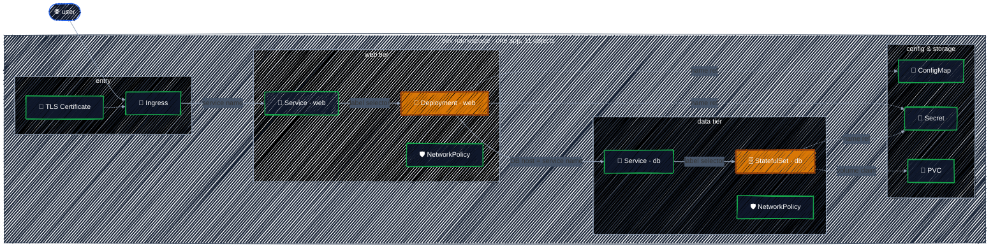
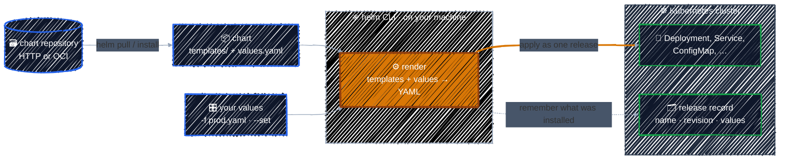

# The Role of Helm in Kubernetes

> Kubernetes runs YAML but has no idea which files belong to one app. Helm packages them, fills in the parts that change, and installs them as one named, versioned unit.

---

Kubernetes understands **objects**: a Deployment, a Service, a ConfigMap. It doesn't understand **applications**. A real app is many objects that have to be created together, configured together, and removed together, and Kubernetes has no word for that group.

### What one "app" really is

Take a small web app with a database, running in a `dev` namespace. It isn't one object. It's eleven:



Without Helm, that's a folder of YAML files and one command:

```text
my-app/
├── ingress.yaml
├── certificate.yaml
├── service-web.yaml
├── deployment-web.yaml
├── networkpolicy-web.yaml
├── service-db.yaml
├── statefulset-db.yaml
├── networkpolicy-db.yaml
├── configmap.yaml
├── secret.yaml
└── pvc.yaml
```

```bash
kubectl apply -f my-app/
```

The arrows are the important part. The objects **refer to each other by name and label**: the Ingress names the Service, the Service finds Pods by label, the Deployment mounts the ConfigMap and Secret by name. Kubernetes checks none of these links when you apply. Get one wrong and the apply still succeeds; the app just doesn't work.

### The problems with plain YAML

That folder works for one app in one environment. Four kinds of trouble start as soon as you need more:

| Problem | What it looks like |
|---------|--------------------|
| **1. Too many objects to manage by hand** | `kubectl get all` doesn't even show ConfigMaps, Secrets, PVCs or Ingresses, so you guess which objects belong together. Removing the app means deleting them one by one, and missing the one someone created by hand last month. |
| **2. Manual edits break things quietly** | The same names appear in many files and must match by hand. A typo in the Service's `selector` leaves it with no endpoints and no error anywhere; renaming the Secret in one file but not the Deployment leaves Pods stuck in `CreateContainerConfigError`. |
| **3. Every environment needs its own copy** | Dev, staging and prod each get a copied folder with a different `replicas`, image tag and hostname. Every fix has to be made three times, and the copies drift apart with each edit. Kustomize helps, within limits; see [Helm vs. Kustomize](helm-vs-kustomize.md). |
| **4. No version history, no rollback** | Nothing records what was applied, or whether someone ran `kubectl edit` since. Rolling back means finding the old YAML, if anyone kept it, and re-applying all eleven files. |

Every one of these comes back to the same gap: **Kubernetes has no idea that these eleven objects are one thing.**

### Helm: the package manager for Kubernetes

Helm fills that gap the same way `apt` (Debian), `yum` (Red Hat), `brew` (macOS) or `npm` (Node.js) do for their worlds. You don't download a program's files one by one and copy them into place; you install a **package**, and the package manager tracks it. Helm does that for Kubernetes: it lets you define, install and upgrade an app made of many Kubernetes objects **with a single command**.

| Helm noun | Like… | What it is |
|-----------|-------|------------|
| **Chart** | a `.deb` / `.rpm` / npm package | Kubernetes YAML templates plus default settings, in a folder or a `.tgz` file |
| **Values** | the config you edit in `/etc` | the settings that fill in the templates: replicas, image tag, hostname… A chart ships defaults in `values.yaml`; you override what you need. |
| **Release** | an installed package | one installed copy of a chart in a cluster, with a name you pick. Install the same chart twice and you get two releases. |
| **Repository** | an apt / yum / npm registry | where charts are published and downloaded from: an HTTP server or an OCI registry |

Those four nouns are all of Helm's vocabulary.

### How the pieces fit



1. A **chart** comes from a repository, or from a folder on your disk.
2. Helm **renders** it: it fills the templates with the chart's defaults plus your **values**, and gets plain Kubernetes YAML.
3. Helm **applies** that YAML to the cluster, the same way `kubectl apply` would.
4. Helm **records a release**: which chart, which values, which revision. That record is what makes `helm upgrade`, `helm rollback` and `helm uninstall` possible.

### The same app, as a chart

Here are the eleven files from the top of the page again, packaged as a chart. They move into `templates/`, and two small files are added:

```text
app-chart/
├── Chart.yaml          # name, version: 2.1.0 (chart), appVersion: 1.4.2 (app)
├── values.yaml         # settings that differ per install: tag, replicas…
└── templates/
    ├── ingress.yaml
    ├── certificate.yaml
    ├── service-web.yaml
    ├── deployment-web.yaml
    ├── networkpolicy-web.yaml
    ├── service-db.yaml
    ├── statefulset-db.yaml
    ├── networkpolicy-db.yaml
    ├── configmap.yaml
    ├── secret.yaml
    └── pvc.yaml
```

Now the whole app goes into the `dev` namespace with one command, and comes back as one thing:

```bash
helm install my-app ./app-chart --namespace dev
```

```text
$ helm list --namespace dev
NAME    NAMESPACE  REVISION  STATUS    CHART            APP VERSION
my-app  dev        1         deployed  app-chart-2.1.0  1.4.2
```

Eleven objects in the cluster, one row in `helm list`. Upgrading, rolling back or removing them is one command each, too.

### What a template looks like

A template is ordinary Kubernetes YAML with a few blanks in it. Here are two of the chart's files, the web Service and the Deployment it sends traffic to:

```yaml
# templates/service-web.yaml
apiVersion: v1
kind: Service
metadata:
  name: {{ .Release.Name }}-web
spec:
  selector:
    app: {{ .Release.Name }}-web        # must match the Pod labels below
  ports:
    - port: 80
```

```yaml
# templates/deployment-web.yaml
apiVersion: apps/v1
kind: Deployment
metadata:
  name: {{ .Release.Name }}-web
spec:
  replicas: {{ .Values.web.replicaCount }}
  selector:
    matchLabels:
      app: {{ .Release.Name }}-web
  template:
    metadata:
      labels:
        app: {{ .Release.Name }}-web    # same expression as the Service's selector
    spec:
      containers:
        - name: web
          image: "myorg/web:{{ .Values.web.tag | default .Chart.AppVersion }}"
```

```yaml
# values.yaml: the defaults
web:
  replicaCount: 1
  tag: ""            # empty: use the chart's appVersion (1.4.2)
```

Notice two things:

- **The label is written as one expression, not typed by hand.** With release `my-app`, the selector and the Pod labels both become `app: my-app-web`. Install it as `shop` and both become `app: shop-web`. As long as every file uses that same expression, they stay in sync, which removes the selector-typo problem from above. Real charts go one step further and define labels once in a shared helper that every template includes, so there's a single place to get them right; you'll write one in [Part 4](../creating-charts/overview.md).
- **What differs per install comes from values.** The image tag defaults to the chart's `appVersion`, so installing chart 2.1.0 deploys app 1.4.2 unless you override `web.tag`. The same chart serves every environment, with a small values file for each:

  ```yaml
  # values-prod.yaml: only what differs from the defaults
  web:
    replicaCount: 3
  ```

  ```bash
  helm install my-app ./app-chart -n dev                          # defaults: 1 replica, myorg/web:1.4.2
  helm install my-app ./app-chart -n prod -f values-prod.yaml     # 3 replicas, myorg/web:1.4.2
  ```

That's the split to remember: **the chart describes the shape of the app; values describe one particular install of it.**

### Back to the four problems

| Problem | Helm's answer |
|---------|---------------|
| too many objects | a **release** groups all eleven: `helm list` shows them as one app, `helm uninstall` removes them all |
| manual edits break things | names and labels come from **one expression** (or helper), so cross-references are written once instead of by hand in every file |
| a copy per environment | **one chart**, plus a small values file per environment |
| no history, no rollback | every change is a **revision**; `helm rollback` restores an earlier one |

Helm doesn't replace `kubectl` or Kubernetes; it sits on top of them and talks to the same API server. It's also how most third-party software ships: Ingress controllers, cert-manager, Prometheus and Argo CD all publish an official chart. The [next page](benefits.md) looks at these benefits, and their costs, in more detail.

---

[↑ Contents](../../README.md) · [Benefits and Limitations of Helm →](benefits.md)
